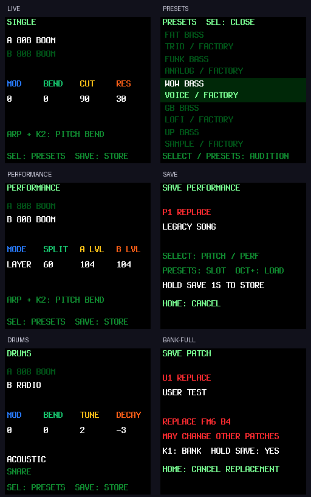

# DINO SYNTH para FM-1

Firmware para tocar el M-VAVE FM-1 en vivo y grabarlo en tu DAW, con los doce motores de SLOOP, dos timbres A/B y visualizadores del dinoperro cósmico.

Base fijada: [SLOOP v2.7](https://github.com/isod89/sloop-fm1/releases/tag/v2.7), commit `ba54ba5f0e7f6e0a1a3499497809e1e6c1ad7e8c`. Se conservan historial, licencias y créditos.

- SINGLE, LAYER, SPLIT y DRUMS; ocho voces compartidas entre sintetizadores, con los límites de cada motor.
- Los 153 patches de fábrica comienzan secos; efectos disponibles para editar y guardar.
- SEL abre una lista de sonidos con nombre, motor y origen FACTORY/USER.
- SAVE guarda 32 patches USER y cuatro PERFORMANCE; espera silencio antes de escribir flash.
- Quince visualizadores, incluidos COSMIC DOG, HALO y NEBULA, con dibujo procedural reactivo.
- Salida analógica, audio USB y MIDI USB/TRS; editor, samples, FM6 y backups.

**Versión de desarrollo: aún no probada en un FM-1 físico.** Las pruebas de host y los límites de memoria pasan; la estabilidad, latencia y ausencia de glitches reales requieren probar el dispositivo.

Lee [DINO.md](DINO.md) para controles, SAVE, compatibilidad de bancos, instalación, recuperación y pruebas de hardware.

[Firmware 0.1-dev](docs/firmware/dino-synth-0.1-dev.fwsc) · [Validación y límites conocidos](DINO-VALIDATION.md) · [Editor offline](docs/webapp/editor/sloop-editor.html)




## Compilar y comprobar

Con Ubuntu WSL2, el toolchain JieLi y SDK fijados en [DINO.md](DINO.md):

```powershell
.\build-dino.ps1 -Test
```

Genera `build/felucca.fwsc`. No instala firmware automáticamente. La suite produce capturas y animación del renderer real en `build/dino-visuals/`.

`python tools/package_dino.py` reúne firmware, editor, instalador, previews y guía en `build/dino-synth-0.1-dev.zip` después de compilar y ejecutar las pruebas.

## Créditos

DINO deriva de [SLOOP](https://github.com/isod89/sloop-fm1) y [Felucca](https://github.com/hugelton/Felucca), de Leo Kuroshita / Hügelton Instruments, sus colaboradores y las bibliotecas citadas en el código. El README original permanece íntegro en [SLOOP-README.md](SLOOP-README.md).

El código mantiene [GPL-3.0-only](LICENSE). Las condiciones específicas de assets y material de terceros están en [LICENSING.md](LICENSING.md).
